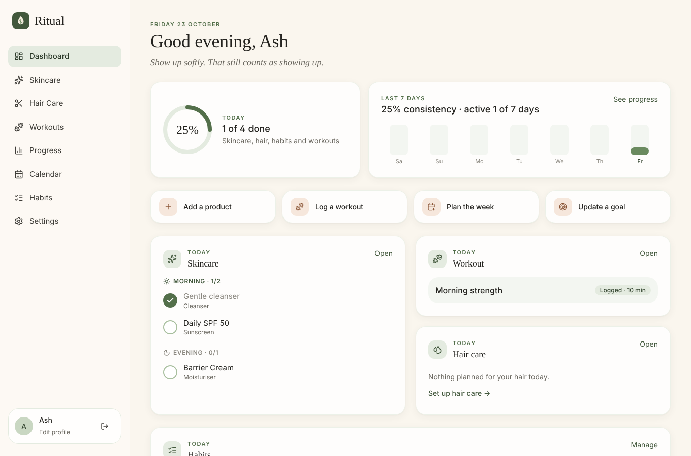

# Ritual

A calm, private wellness companion for **skincare, hair care, workouts and daily habits**. Each person has their own
account; nobody can see anyone else's data. Built with React + Vite + TypeScript on Supabase (Postgres, Auth, Storage)
and deployable for free on Netlify or Vercel.



---

## What's inside

| Area | Features |
| --- | --- |
| **Accounts** | Email + password sign-up, sign-in, sign-out, password reset, change email/password, sign out of all devices, profile name + private avatar, timezone, units (kg/lb, cm/in), week start. |
| **Dashboard** | Greeting, date, daily message, today's skincare (AM/PM), hair care, planned workout (start/resume), habits, today's completion ring, 7-day consistency, quick actions. |
| **Skincare** | Products with brand, type, key actives, usage, notes, start and replace-by dates. Morning/evening routines on chosen days, application order, daily checklist, week strip, pause / archive / delete. General cautions for active combinations (e.g. retinoid + AHA) and a missing-sunscreen nudge — clearly not medical advice. |
| **Hair care** | Products and product-less activities (wash, condition, scalp care, treatments, styling) on any weekly schedule, today's checklist, weekly schedule grid, consistency. |
| **Workouts** | Fitness profile (goal, experience, location, equipment, preferred days, session length). 64-exercise library with original instructions, custom exercises with optional demo links. 10 editable starter templates. Workout builder (order, sets, reps/seconds, weight, rest, notes). Weekly planner with rest days, move/edit/skip, copy last week, fill preferred days. Session mode with set-by-set logging, rest timer, pause/resume, add/remove exercises and sets, "last time" hints, finish summary with personal bests, effort and notes. History, exercise progression charts (heaviest set + clearly-labelled estimated 1RM). |
| **Body & goals** | Optional body weight/measurements with charts, goals that compute progress from real logs (lifts, workouts per week, measurements) or manual values, private progress photos (signed URLs only). |
| **Habits** | Custom habits with icon, days and optional reminder time, weekly check-in grid, optional gentle streaks, archive without losing history. |
| **Progress** | 7/30/90/365-day or custom range: overall, skincare, hair, habit completion, workouts, training time, activity heatmap, completion and workouts-per-week charts, exercise progress, goals. Days with nothing scheduled are excluded, never counted as zero. |
| **Calendar** | Month view combining every area; select a day to see planned vs. completed, tick things off for past days, plan workouts or rest days. |
| **Settings** | Profile, skincare and hair-care product management, workout preferences, units & display, notifications, account security, data export (JSON + CSV) and self-service account deletion. |
| **PWA** | Installable on phones and desktops (manifest + service worker). The service worker never caches API data. |

### Honest limitations

- **Reminders** use the browser's Notification API and only fire while Ritual is open in a tab or as an installed app.
  There are no server-sent push notifications when the app is closed. The Settings page says this to users.
- **Progress photos** are not included in the JSON export (the export has their records, not the image files).
- Editing a **habit's** days applies to its past too (routine items for products/activities are versioned and don't have
  this limitation).
- Goal targets are stored as numbers in the unit you chose when you created them; if you later switch kg ↔ lb, edit the goal.

---

## Project structure

```
ritual/
├── supabase/
│   ├── migrations/
│   │   ├── 20261023000001_schema.sql        # tables, constraints, indexes, RLS, account deletion
│   │   ├── 20261023000002_storage.sql       # private avatar + progress-photo buckets and policies
│   │   └── 20261023000003_seed_library.sql  # shared exercise library + starter templates (idempotent)
│   └── tests/
│       ├── rls_test.sql                     # 30+ security assertions (two users, anon, deletion)
│       ├── supabase_shim.sql                # minimal auth/storage stand-in for plain Postgres
│       └── run-local.sh                     # spins up a throwaway Postgres and runs everything
├── src/
│   ├── api/            # data access + React Query hooks per domain (care, habits, fitness, sessions, body, profile)
│   ├── auth/           # AuthProvider (session, recovery, cache clearing on sign-out)
│   ├── components/     # ui/ (design-system primitives, toasts, confirm dialog) and layout/ (shell, nav, logo)
│   ├── features/       # one folder per page: dashboard, care, habits, workouts, progress, calendar, settings, auth
│   ├── lib/            # pure logic: dates, scheduling maths, units, skincare cautions, workout maths, export, reminders
│   └── types/db.ts     # row types mirroring the SQL schema
├── public/             # manifest, service worker, icons, Netlify _redirects
├── docs/SCHEMA.md      # database design notes
├── netlify.toml / vercel.json
└── .env.example
```

---

## 1. Create the Supabase project

1. Sign up at [supabase.com](https://supabase.com) and create a new project (free plan is fine). Pick a region near you
   and save the database password somewhere safe.
2. Open **SQL Editor → New query**, paste the contents of each migration **in order** and click **Run**:
   1. `supabase/migrations/20261023000001_schema.sql`
   2. `supabase/migrations/20261023000002_storage.sql`
   3. `supabase/migrations/20261023000003_seed_library.sql`

   Or, with the [Supabase CLI](https://supabase.com/docs/guides/cli): `supabase link --project-ref <ref>` then `supabase db push`.
3. Check **Table Editor**: every table should show a green **RLS enabled** badge, and **Storage** should list two
   private buckets, `avatars` and `progress-photos`.

### Auth settings (important)

In **Authentication → URL Configuration**:

| Setting | Value |
| --- | --- |
| Site URL | your production URL, e.g. `https://ritual-yourname.netlify.app` |
| Redirect URLs | `http://localhost:5173/**` and `https://ritual-yourname.netlify.app/**` |

The app sends people back to `/` after confirming their email and to `/reset-password` from reset emails, so both must
be allowed by those patterns.

**Email delivery.** Supabase's built-in email sender is for testing only: it is heavily rate-limited (at the time of
writing about 2 emails per hour per project) and only delivers to your project's team members. So for Ifsia and friends
to receive confirmation and password-reset emails you need one of:

- **Custom SMTP (recommended):** *Authentication → Emails → SMTP Settings*, using a provider with a free tier such as
  Resend, Brevo or Postmark. Then raise the email rate limit under *Authentication → Rate Limits*.
- **Small private group alternative:** turn off *Authentication → Sign In / Providers → Email → Confirm email*. People
  can then sign up and are signed in immediately. Password-reset emails still need SMTP.

---

## 2. Run it locally

Requirements: Node.js 18.18+ (20 LTS recommended).

```bash
git clone <your repo url> ritual && cd ritual
npm install
cp .env.example .env.local
# edit .env.local:
#   VITE_SUPABASE_URL      = Project Settings → API → Project URL
#   VITE_SUPABASE_ANON_KEY = Project Settings → API → anon / public key
npm run dev            # http://localhost:5173
```

The **anon key is designed to be public** — Row Level Security protects every table. **Never** put the `service_role`
key in this app, in `.env.local`, or in Netlify/Vercel. `.env*` files are git-ignored (only `.env.example` is committed).

If the variables are missing the app shows a setup screen instead of running — it never silently falls back to saving
data on the device.

### Scripts

| Command | What it does |
| --- | --- |
| `npm run dev` | Development server with hot reload |
| `npm run build` | Type-checks and builds the production bundle into `dist/` |
| `npm run preview` | Serves the production build locally |
| `npm run typecheck` | TypeScript only |
| `npm test` | Unit tests for dates, scheduling, streaks, units, workout maths and skincare cautions |
| `npm run test:db` | Applies all migrations to a throwaway local PostgreSQL 15+ and runs the RLS suite |

---

## 3. Deploy

### Netlify

1. Push the repo to GitHub.
2. Netlify → **Add new site → Import an existing project** → pick the repo. Build settings come from `netlify.toml`
   (`npm run build`, publish `dist`).
3. **Site configuration → Environment variables**: add `VITE_SUPABASE_URL` and `VITE_SUPABASE_ANON_KEY`.
4. Deploy. Then add the Netlify URL to Supabase **Site URL** and **Redirect URLs** (above).

SPA routing works through `public/_redirects`.

### Vercel

1. **Add New → Project** → import the repo. `vercel.json` sets the build and SPA rewrites.
2. Add the same two environment variables (Production + Preview), deploy, and add the Vercel URL to Supabase.

Vite reads `VITE_*` variables **at build time**, so redeploy after changing them.

---

## Free-tier notes

Free plans are generous for a personal app shared with a few friends, but they are not unlimited, and providers change
their pricing and allowances. Check the current pages before relying on them. At the time of writing:

- **Supabase Free:** about 500 MB database and 1 GB file storage per project, up to two free projects, and **projects
  pause after a week of inactivity** (restore them from the dashboard; opening the app regularly keeps it awake). The
  built-in email sender is for testing only (see above). [supabase.com/pricing](https://supabase.com/pricing)
- **Netlify Free:** a monthly credit allowance shared by deploys, bandwidth and requests; when it runs out, sites pause
  until the next cycle (no surprise charges). [netlify.com/pricing](https://www.netlify.com/pricing/)
- **Vercel Hobby:** for **non-commercial personal use only**, with monthly caps on bandwidth and requests.
  [vercel.com/pricing](https://vercel.com/pricing)

Progress photos are the main thing that uses storage; uploads are capped at 8 MB each (avatars at 2 MB).

---

## Security model

- **Every personal table has RLS** with `user_id = auth.uid()` checks for read **and** write, and child rows (routine
  completions, template exercises, session exercises, sets, …) also require that the parent row belongs to the same user.
  Nobody can attach data to someone else's records.
- The shared **exercise library and starter templates** have `user_id = NULL`: readable by signed-in users, writable by no
  one through the API.
- The **anon role has no table privileges at all**; everything requires a signed-in user.
- **Storage buckets are private.** Objects must live under `<user id>/…`, and images are shown through signed URLs that
  expire after an hour.
- **Account deletion** (`delete_my_account()`) is a `security definer` function that can only delete the caller's own
  auth user; all their rows cascade. The app removes their storage files first.
- On sign-out (or a different user signing in) the client-side query cache is cleared, so one person's data never
  flashes up for another on a shared device.
- CSV exports neutralise spreadsheet formula injection. Demo links must be `https://` and open with `rel="noopener noreferrer"`.

### How this was tested

- `npm run test:db` — the RLS suite: two users each create one of everything; the test proves neither can read, update,
  delete or attach to the other's data in any table or bucket, that the library and starters are read-only, that
  anonymous requests are refused, that constraint checks hold, and that account deletion removes exactly one user's data.
- An end-to-end run against a local Supabase-equivalent stack (Postgres 16 + Supabase Auth/GoTrue + PostgREST) using the
  real `supabase-js` client, followed by a browser walkthrough of sign-up, products, routines, persistence after reload,
  pausing, hair activities, habits, a full workout session with rest timer and finish, planner, template builder, goals,
  measurements, progress, calendar, settings, export, unit switching, mobile navigation and sign-out.
- Storage upload/download was verified at the policy level (SQL), not against a live Storage server — try uploading an
  avatar once after deploying.

---

## Troubleshooting

| Problem | Fix |
| --- | --- |
| Setup screen: "isn't connected to a database yet" | `.env.local` (or the hosting env vars) is missing a value. Restart `npm run dev` / redeploy after adding it. |
| "Invalid API key" | You pasted the wrong key. Use the **anon/public** key from Project Settings → API. |
| Sign-up says "check your inbox" but no email arrives | Built-in email only reaches team members and is rate limited — set up custom SMTP or turn off email confirmation (see Auth settings). |
| "Email rate limit exceeded" | Same cause; configure SMTP and raise *Authentication → Rate Limits*. |
| Confirmation / reset link opens `localhost` in production | Set **Site URL** and **Redirect URLs** to your deployed URL. |
| Reset link says it has expired | Links are single-use and must be opened in the same browser that requested them. Request a new one. |
| "relation … does not exist" / empty exercise library | A migration wasn't run, or ran out of order. Re-run them in order (they're safe to re-run on a fresh project; the seed skips itself if the library exists). |
| "That action is not allowed for your account" | An RLS policy rejected the request — usually the session expired. Sign out and back in. |
| 404 when refreshing a page on the deployed site | Make sure `public/_redirects` (Netlify) or `vercel.json` (Vercel) was deployed. |
| App can't reach Supabase after a quiet week | The free project paused. Restore it from the Supabase dashboard. |
| Notifications never appear | Allow notifications for the site in browser settings and keep Ritual open. iOS only allows them for the installed (Add to Home Screen) app. |

---

## Disclaimer

Ritual is a personal tracker. Its skincare cautions and workout templates are general information, not medical advice,
diagnosis or an individual training prescription. Introduce active ingredients gradually, warm up, progress gradually,
and stop any exercise that causes pain, dizziness or unusual symptoms.
